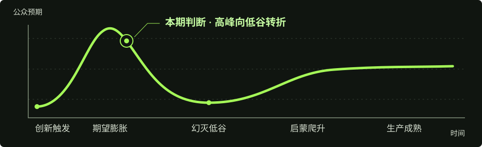

# Agentic Thinking EP06 · Hype Circle

**AI 技术周期的趋势**

Oratis · 2026 年 11 月 18 日（周三）上午 11:00，北京时间

## 01 · Gartner Hype Cycle：我们走到哪了？

2022 年 11 月 30 日，ChatGPT 走到公众面前。本期判断，生成式 AI 正从期望膨胀期走向幻灭低谷。

**高峰**　天时、地利、人和促成 Seedance 和 Claude Code 的爆发，增长又给 AGI 愿景带来关注。

**转折**　当失败和返工成为日常，媒体关注下降，跟风者退出，用户留下来要看产品能否持续改进。

### 讲稿

2022 年 11 月 30 日，OpenAI 发布 ChatGPT。普通人打开网页就能和模型对话，这给了我们一个观察本轮公众预期的起点。Gartner 的曲线描绘人们对技术的预期。图中标出的位置是我对生成式 AI 市场的判断。代码助手、视频生成、游戏陪伴各有自己的节奏。

在期望膨胀期，一段惊艳演示比十次失败更容易传播。少数成功案例得到反复报道，用户自然会期待每次都有同样的结果。到了转折处，企业把演示放进日常流程，发现慢、贵、需要返工。媒体关注开始减少，跟风的供应商难以续约，有的退出，有的放弃产品。留下的团队要能把早期用户最常遇到的问题一项项修好。

为什么高峰也能长出好产品？天时是用户已经在等这件事，地利是模型跨过可用门槛，人和是团队把能力做成顺手的产品。Seedance 2.0 支持把参考图、声音和视频用于创作，创作者可以把可见的效果直接展示给下一位用户。Claude Code 则把模型接进开发者原有的工作环境。Anthropic 在 2025 年 12 月披露，Claude Code 在六个月内达到 10 亿美元年化收入规模。这是按当时速度折算的收入，和六个月的实际累计收入是两个口径。

增长又会给更远的承诺提供听众。OpenAI 在 2025 年 12 月披露 ChatGPT 每周服务超过 8 亿用户，早在章程中就提出让 AGI 造福全人类。人们容易把眼前的增长接到 AGI 的故事上。周活可以说明多少人在用，离 AGI 有多远还需要另一套证据。

[Gartner 曲线方法](https://www.gartner.com/en/research/methodologies/gartner-hype-cycle) · [ChatGPT 发布](https://openai.com/index/chatgpt/) · [Seedance 2.0 发布](https://seed.bytedance.com/zh/blog/official-launch-of-seedance-2-0) · [Claude Code 增长口径](https://www.anthropic.com/news/anthropic-acquires-bun-as-claude-code-reaches-usd1b-milestone) · [OpenAI 用户口径](https://openai.com/index/the-state-of-enterprise-ai-2025-report/) · [OpenAI 章程](https://openai.com/charter/)

## 02 · 中国开源 AI 如何缩短期望膨胀期？

过去，一家美国实验室展示新能力，到客户有第二个可用选择，中间有一段时间差。开放权重让客户能更早拿自己的任务做比较。

### DeepSeek-R1

2025 年 1 月公布权重和六个蒸馏模型。应用团队可以下载模型，用自己的题目重跑推理任务。

### Qwen3

2025 年 4 月开放多种尺寸的模型。团队可以按自己的硬件与延迟要求，测试哪一档已经够用。

**本期推断**　当替代方案更早出现，客户也会更早追问质量、交付成本和续约理由。靠能力稀缺维持高预期的窗口随之缩短。

### 讲稿

我说的“打破美国的创新周期底层逻辑”，特指一种常见商业路径。前沿实验室先展示突破，开发者排队接入，市场在一段时间内按领先者的演示想象价值，随后竞争者才有机会验证或替代它。当同类能力能够下载、部署和改造，应用团队自己就能做这个比较，也有了与供应商议价的依据。

比如做游戏攻略，团队可以把一批玩家真问过的问题交给两个模型，要求它们说明依据、在相同延迟内作答。开放模型如果过线，采购方就有替代选项。如果差距仍大，前沿模型的溢价也更容易说清。自部署还要付硬件、运维和容量闲置的成本，比较时要全部算进去。

判断这个窗口有没有缩短，可以按任务跟踪两个日期：前沿能力首次可用日，以及第二个方案首次通过同一验收集的日期。再看客户何时开始试用或切换。上面的发布记录说明验证途径已经出现，具体缩短多少还要有这种纵向记录。

[DeepSeek-R1 发布](https://api-docs.deepseek.com/news/news250120) · [Qwen3 发布与开放权重](https://qwenlm.github.io/blog/qwen3/)

## 03 · 低谷期，怎样同时改产品和毛利？

假设一条交付成功的视频收 10 元。用户只付一次，团队要承担每次生成和返工的成本。

| 每单交付（示例） | 整条重做 | 只修失败镜头 |
|:---|---:|---:|
| 确认收入 | 10 元 | 10 元 |
| 首次生成＋其他直接交付成本 | 6 元 | 6 元 |
| 返工成本 | 3 元 | 1 元 |
| **每单毛利** | **1 元** | **3 元** |
| **毛利率** | **10%** | **30%** |

**每周看两件事**　用户能否更快拿到愿意保留的成片？算上失败尝试，每个付费订单还能留下多少钱？

### 讲稿

热度退下去之后，用户还肯回来、每次交付还有毛利，团队才有条件持续改产品。毛利等于确认收入减直接交付成本，毛利率再除以确认收入。表里两种方案的首次成本相同，变化只有返工范围。保住好镜头，用户少等一轮，团队每单多留两元。表中数字是讲解假设。

产品侧，每周抽看用户放弃的任务，区分是模型画错、工具丢了素材，还是等待太久。先修最常见的一个原因，再看同一批任务的首轮采纳率和交付时间。商业侧，把推理、工具、存储、人工交付以及失败重试归到相应订单，按付费档位核算毛利。退款应冲减收入。

例如，先让创作者确认低成本分镜，再提供付费高清成片。做小范围测试时，同时看付费转化、复用率、交付质量与毛利。只靠低配模型压成本，如果付费用户开始流失，产品和商业化就没有一起改善。研发投入、获客费用和现金余额还决定公司能撑多久。

## 04 · 模型即产品的悖论

用户第一次来，可能只因为某个模型会生成一段漂亮的视频。等同一个模型也进了别人的产品，用户第二次为什么还要回来？

### 第一次生成

上传一张角色图，拿到五秒钟的镜头。只要输出足够惊艳，一项模型能力就能构成完整的首次体验。

### 第二次修改

“保留刚才的脸和声音，只改最后两秒。”此时需要原素材、镜头边界、编辑工具和版本记录。谁能接着改，谁就更有机会留下用户。

**替换试验**　保留项目、素材和工具，更换底层模型。观察用户能否按原标准交付，究竟是哪一步失去了价值？

### 讲稿

对模型团队，能力突破可以直接生长为产品。对使用第三方模型的应用团队，这既是起点，也是一个风险：当供应商涨价、限流，或者自己推出相同入口，产品还能否履行原有承诺？

把试验做具体。选十个已交付的项目，把用户接受过的版本留作参照。换模型后重做用户当时提过的一次修改，请创作者判断角色是否一致、改动是否局部、结果是否可继续使用，再记录交付成本。若替换后核心价值几乎全部消失，我们就不能把这项价值算作应用自身的竞争力。至于在今天先用一个模型起步，完全可以由这个试验决定下一步要补什么。

## 05 · 非模型产品的三种机会

同一个承诺可以由不同模型完成。应用团队要掌握选择模型的依据、执行任务的过程，以及真正能改变结果的工具。

### Model router

按用户价值定质量和等待上限，按技术能力筛选输入模态和工具支持，再按成本预算路由。主模型不可用时，备选也要通过同一验收标准。

### Data · harness · context

Data 留下真实任务与纠错样本。Harness 管理执行、重试和验收。Context 把当前目标、素材版本和必要记忆送到模型眼前。

### 独特的 tool

把“只换一个镜头”做成可调用的动作。输入原片、镜头和改动要求，输出可预览、可撤回的新版本。

### 讲稿

如果少了某个模型，产品就会丢掉绝大部分价值，我会判断它作为独立应用还没有成立。多模型也有工程代价。先拿一个用户真正会付费的结果定标，再看第二个模型能不能以可接受的成本接手。这样才知道多接一家供应商解决了什么。

系列第 3 期的 Cuddler Model Router 案例里，付费模型发生限流时，早期回退链只覆盖免费模型。候选模型是有的，用户应得的服务等级却接不上。这个例子说明，路由必须同时适配用户购买的价值、候选模型的实际能力以及包括重试的交付成本。

三者也可以在一次任务里配合。路由器选择会做局部重绘的模型，harness 负责提交任务、读回结果并检查版本，context 提供锁定的角色图和待改镜头。工具把新版本交还创作者。创作者最终保留哪一版，又给下一轮评测留下数据。

[EP03 · Cuddler Model Router 案例](https://github.com/oratis/AgenticThinking/blob/ca0a3cf/EP3%20Model%20over%20Everything/src/parts/03-part-c.md)

## 06 · 现有模型已经打开哪些机会？

### 工作从提问开始

“Knowledge is to know the right answer, but intelligence is to know the right question.” 问对问题的关键，是了解现场，并说清答案将改变谁的哪个决定。

### 30B 级模型可以先上场

我的假设是，多数边界清楚、能调用工具验收的常规子任务，用约 300 亿参数的模型就值得一试。蒸馏还能把其中一部分能力迁移到更小的模型。

### 娱乐走向消费即生成

创作者先用模型试分镜、剪预告。再往前一步，观众看完这一幕，选择跟谁走，系统才为他生成下一幕。

### 讲稿

当 Agent 能查资料、调工具、跑验证，人的判断更集中在要解决哪个问题。运营说“帮我分析流失”，Agent 可以列出十种解释。换一个问题：“第一次生成失败的付费用户，有多少在重试前离开？如果占比最高，我们这周先改哪一步？”这时才知道要查哪些事件、谁能采取行动、用什么结果验证判断。

30B 是工程起跑线。比如意图分类、填写工具参数、按已有资料作答，都能给出验收样本。先用真实任务测通过率、延迟和每次成功成本，能过线的交给小模型，过不了的升级或交人。DeepSeek-R1 系列公布了 32B 及更小的蒸馏模型；这些模型的公开基准，只能作为选型线索。“多数”是限定场景里的待检验假设，现场评测决定哪些任务真能交付。

娱乐的变化也有先后。创作的一头是构思、分镜和预演，一尾是成片后的剪辑、配音和分发。两头先省工时，再尝试让观看动作参与下一幕的生成。这种个性化要成立，角色得连贯，等待得够短，每次生成的成本也要有收入承接。

[DeepSeek-R1 蒸馏模型与评测](https://github.com/deepseek-ai/DeepSeek-R1) · [Qwen3 模型规格](https://qwenlm.github.io/blog/qwen3/)

## 07 · 陪伴和内容，用户为什么回来？

|  | 陪伴：逗逗 AI、HakkoAI | 内容：Cuddler |
|:---|:---|:---|
| 用户回来做什么 | 和看过上一局的伙伴再玩一局 | 看下一幕，或亲手改出另一版 |
| 产品先抓什么 | 上下文。知道我们刚经历了什么、何时该开口 | 工具。把选择变成可看、可改的作品 |
| 怎样判断做对了 | 下次见面，用户还要重新交代多少？ | 看完之后，有多少人愿意接着改、接着看？ |

### 讲稿

这两条路可以相交。逗逗 AI 和 HakkoAI 的产品资料都强调感知游戏画面和实时语音，HakkoAI 还把跨游戏记忆作为卖点。对一个陪玩的伙伴，刚才怎么输掉这一局、玩家此时想不想听攻略，会直接改变一句话是否合适。

Cuddler 也有角色聊天，同时提供剧集、分支故事、漫画和创作入口。这里把它放在内容一侧，是为了讨论另一种回访动机：观众喜欢一个角色，想看另一个结局，或者想把自己的那段对话变成一幕戏。下面两页分别用设计示例说明两种回访动机该怎样服务。

[逗逗游戏伙伴](https://m.doudou.fun/) · [HakkoAI](https://www.hakko.ai/) · [Cuddler 产品说明](https://cuddler.ai/docs/what-is-cuddler)

## 08 · 陪伴的设计，从何时开口开始

玩家上次说“让我自己摸索”。今天又在同一个 Boss 前倒下，伙伴该说什么？

### 眼前发生了什么

读到玩家刚结束战斗，先留一点安静。一次失败只描述了局势，玩家此刻想不想听攻略还未知。

### 上次约定了什么

取回玩家明确表达过的偏好。等他主动问“刚才怎么躲”，再结合刚才那一下动作，给一句针对性的提示。

### 下次要记住什么

玩家说“这个 Boss 可以提醒我”。让他确认这条例外只适用于当前 Boss，也能随时改回去。

### 讲稿

这是围绕逗逗 AI、HakkoAI 所代表的游戏陪伴方向做的设计推演。两个玩家看到完全相同的失败画面，一位在练无提示通关，一位只想尽快过关。前者可能希望伙伴安静，后者可能希望伙伴在下一击前开口。知道屏幕上有什么，仅仅解决了一半问题。

把近期事件和长期偏好分开。战斗画面过了就可以丢掉，经过用户确认的“这个 Boss 可以提醒”才值得跨会话保存，并写下适用对象与更新时间。把查看、改正和删除记忆的入口交给用户，免得一次误解跟着对话一直走。

用一组配对回放来验收。画面完全相同，只改一条历史偏好，看伙伴是否改变出声时机。再看玩家关掉提示、纠正记忆、隔天重新解释的频率。对这种产品，少说一句也可能是一次正确响应。

[逗逗 AI 产品说明](https://www.magicneko.com/article/2/) · [HakkoAI 场景感知与记忆](https://www.hakko.ai/blog/article/introduce-hakkoai/)

## 09 · 内容的设计，从一个可修改的镜头开始

在 Cuddler 的内容场景里，观众看完告别戏，想试一个改动：“让她留下来，前两个镜头我很喜欢。”

### 保留

锁住前两个镜头、角色参考和声音，记录用户希望修改的最后一个镜头。

### 生成

工具只重做指定镜头，返回新片段、预览和本次成本。生成失败时保留原版，让创作者可以重试。

### 选择

并排预览两个结尾。观众选中的版本可以分享，也可以成为下一幕的起点。

**工具的验收**　指定镜头改了，其他镜头保住了，改一次花多少钱也能查到。

### 讲稿

Cuddler 已公开介绍从对话生成场景、观看剧集和体验分支故事的入口。这里的单镜头修改是围绕这些入口展开的设计示例。把一句“我想看另一种结局”直接发给视频模型，模型可能交回整部新片，用户最喜欢的两个镜头也跟着变了。

一个可复用的工具需要读得懂作品结构。输入包括原版本、镜头标识、角色和声音参考、改动意图及预算上限。输出包括新片段、它替换的位置和费用。超时重试要能识别同一任务，避免重复扣费。发布之前仍可回到原版本。

对用户，看的是改动采纳率以及看完是否愿意继续生成。对团队，看的是每个被采纳版本的总成本，失败、等待和废片都要归到相应任务。第 3 页那两元毛利的改善，在这里对应一个具体的工具边界。

[Cuddler 官方创作与观看指南](https://cuddler.ai/docs) · [同一角色跨视频、互动剧与漫画](https://cuddler.ai/blog/beyond-chat-multimodal-storytelling)

## 10 · 数据是最终的壁垒

如果只留下两条成片，后来的人很难知道哪一帧出了问题。把原任务、改动和选择连起来，才能知道下一版应该改什么。

| 一次交付留下什么 | 下次可以检验什么 |
|:---|:---|
| 原片、镜头范围和用户要求 | 工具是否只修改了指定位置？ |
| 旧版、新版，以及创作者保留或退回的原因 | 人物变脸和结尾写错，哪一种导致返工？ |
| 被采纳版本的总尝试次数、耗时和直接成本 | 换模型后，能否更便宜地交付同等质量？ |

**最难补采的记录**　用户当时为什么放弃那个看起来也说得通的版本？

### 讲稿

陪伴里也有同类数据。玩家关掉攻略提醒，是嫌它太频繁、早已知道答案，还是只想自己探索？一个关闭事件很难回答。若玩家愿意补一句原因，把这句纠正限定在这个场景里，比累积一堆无标记聊天更有助于改产品。

取得相应授权后，把这类记录整理成可回放的难例。用于评测的一批样本单独保留，避免调参时答案已经泄露。每次换模型或工具版本，重跑相同任务，检查历史失败是否复发，再观察新用户的真实表现。

壁垒来自这条可重复的工作：用户在什么约束下做了哪个选择，团队能否据此改对下一版。这类有上下文、有结果、有弃选原因的数据，只有实际参与过交付的人才有机会收集。用量很大却找不到失败原因，数据的学习价值仍然有限。

## 11 · 我们离 AGI 还有多远？

### 架构的疑问

我的判断是，今天的 Transformer 不太可能直接成为 AGI 的最终架构。长任务需要反复推理、调用工具和纠错，每一次尝试都要付能量成本。

### 更值得测的效率

固定任务、质量门槛和延迟预算，比较每千瓦时能交付多少个合格结果。把失败、重试和工具消耗计入相同的测量边界。

### 自我改进仍需要数据

系统可以生成自己的练习题和解法，还得获得能检验对错的反馈。开放世界里，那些罕见失败、专家纠错和延迟出现的结果尤其难得。

**团队今天能做的事**　找到别人看不到的一次失败，取得授权，记下它为什么失败，并让下一版在同一任务上做得更好。

### 讲稿

我给不出可信的 AGI 倒计时。Transformer 的能力已经支持丰富产品，但如果长任务的每个纠错回合都要消耗大量计算，单靠扩大现有架构很难说明如何跨过能效门槛。我预期，模型架构研究会越来越重视单位能量能换来多少可靠智能。有关推理能耗的实测支持把任务与硬件条件纳入比较；“哪种架构最终通向 AGI”仍是开放问题。

衡量时，把同一组真实任务交给两套系统，在相同验收和延迟约束下记录端到端能耗。即使一个模型每个 token 更省电，若它需要多次返工才交付，也可能在每个合格结果上更费电。别把训练能耗与单次推理混在一个分母里。

AlphaGo Zero 用自我对弈生成训练经历，围棋规则给每盘提供明确的胜负信号。真实世界的“这一句合不合时宜”“这版镜头值不值得留”，没有棋局终局那样现成的裁判。从依赖现成数据，到自己生成经历，最后仍要靠数据判断哪次尝试更好。发现别人没有的数据，做最难获取的数据，始终值得投入。

[推理能耗的跨任务实测](https://arxiv.org/abs/2311.16863) · [AlphaGo Zero 自我对弈研究](https://www.nature.com/articles/nature24270)
